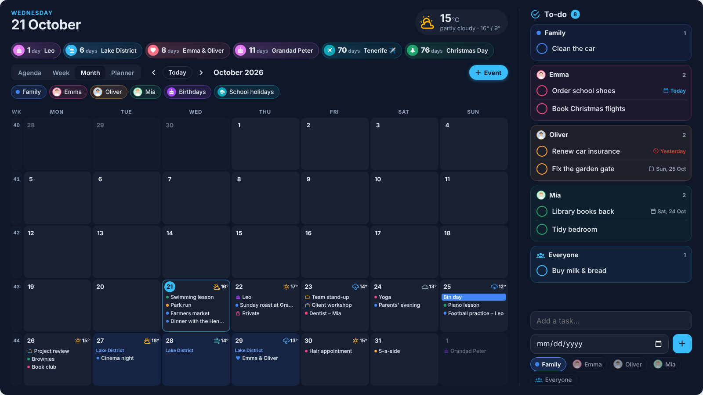
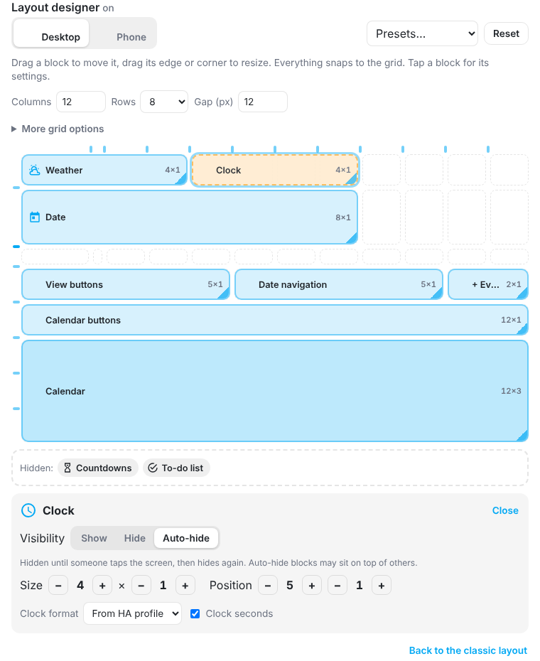
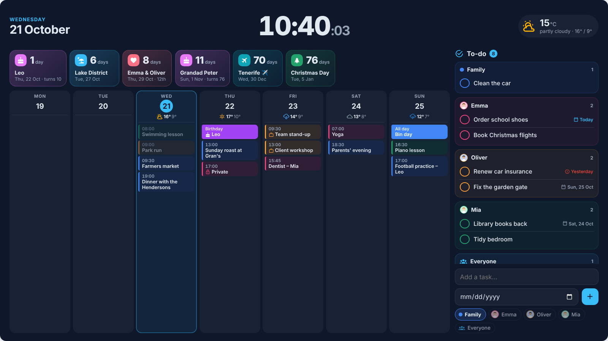
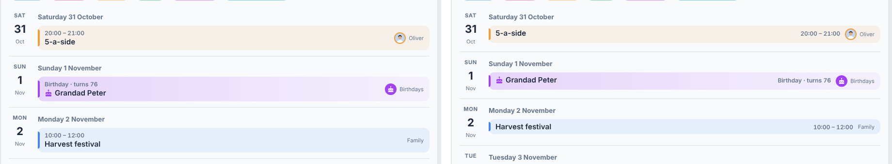
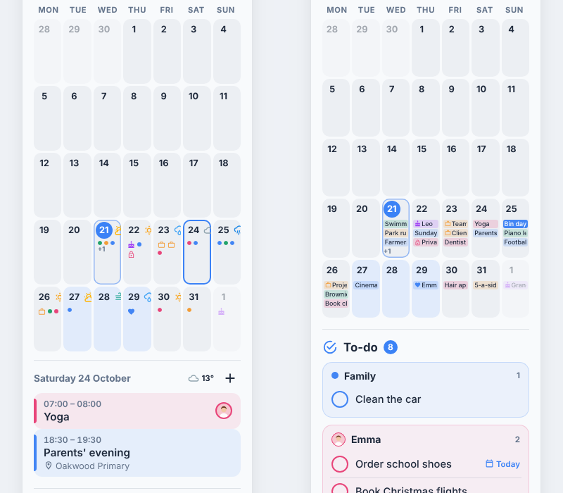
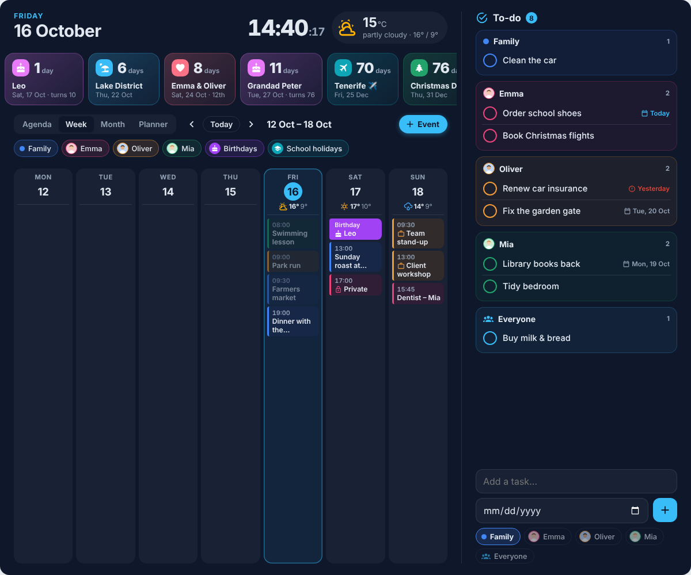

# Home Calendar Card

[](https://github.com/mimikm/Home-Calendar-Card/actions/workflows/validate.yml) [](https://hacs.xyz) [](https://github.com/mimikm/Home-Calendar-Card/releases) [](https://github.com/mimikm/Home-Calendar-Card/releases) [](https://github.com/mimikm/Home-Calendar-Card/releases/latest) [](https://github.com/mimikm/Home-Calendar-Card/stargazers)

A clean, modern calendar card for Home Assistant. Shows your **Google**, **Apple iCloud** (via CalDAV) or any other Home Assistant calendar in **Agenda**, **Week**, **Month** and **Planner** views, with the **daily weather forecast** on every day — and lets you **add events** straight from the dashboard, choosing which calendar they go into.


## Screenshots

| Wall display – Month (Midnight) | Wall display – Week (Sunset) |
|---|---|
|  |  |
| **Wall display – Agenda (Forest)** | **Adding an event** |
|  |  |

**Planner view – a column for each person (Midnight)**


**Five colour themes**


**On a phone (Graphite)**


<sub>Screenshots use a fictional family – all names, places and events are made up.</sub>

## Features

- 🧩 **Layout designer** – design the card on your own grid: drag, resize and hide blocks (date, clock, weather, countdowns, buttons, calendar, to-do), auto-hide blocks until tapped, separate phone layout and presets
- ⚙️ **Layout options** – reorder or hide the parts above the calendar, and put event times next to the title for a compact Agenda
- 📱 **Phone-friendly Month view** – tap a day to list its events under the month, or show short titles in the day boxes
- 🔢 **Week numbers** – ISO week numbers in Month, Week and Planner views
- 📅 **Four views** – Agenda (grouped by day), Week (7 columns, stacks on phones), Month (grid, dots on phones) and Planner (a column per person, like a printed family planner)
- 🌦️ **Weather built in** – current conditions in the header, daily icon, high/low and rain chance on each day, forecast shown when you add an event
- ➕ **Add events** – title, **event type** dropdown, **repeat** dropdown, calendar picker (colour-coded chips), all-day toggle, start/end, location, description
- 🏷️ **Event types** – Standard, Holiday, Birthday, Anniversary, Work event and DHS out of the box (fully customisable), each with its own icon and behaviour
- ✏️ **Edit events** – tap an event → **Edit** to change the title, time, type, repeat, location or notes, or move it to another person's calendar
- 🗑️ **Delete events** – tap an event → **Delete**, with a confirmation; repeating events let you delete *this event*, *this and following* or *all events*
- 👨‍👩‍👧 **One calendar per person** – link a calendar to a `person` entity to show their profile photo (or initials) on chips and events, plus a shared family calendar
- 🎂 **Birthdays** – birthday calendars get a cake icon and "turns 36" when the birth year is in the event
- 🎉 **Holidays** – bank/school holiday calendars appear as a banner on the day instead of cluttering the event list
- ⏳ **Countdowns** – a strip of cards counting down to holidays, birthdays, trips or any date (one-off or yearly)
- 🎨 **Per-calendar colours** with toggle chips to show/hide calendars (remembered per browser)
- 🔴 **"Now" highlight** for events in progress, past events faded, multi-day events labelled *Day 2/3*
- 📱 **Responsive** – adapts to the card's width, works in Sections and Masonry dashboards
- 🌍 Dates and times follow your HA language and 12/24-hour profile setting
- ✅ **Shared to-do list** – tasks grouped by person (using your calendar names), optional due date, anyone can add, tick to complete (with Undo); updates live on every device
- 🖥️ **Wall display mode** – fills the whole screen, stretches Month/Week to the full height, to-do list as a sidebar, auto-scales text for distance viewing and keeps the screen awake
- 🎨 **5 colour themes** – Nordic, Sunset, Forest, Midnight and Graphite, or follow your HA theme (light and dark)
- 🛠️ **Visual editor** – theme picker, and a calendar list where you can rename each calendar, set its colour, link a person and choose its type
- 🌙 **Night mode & screensaver** for always-on screens – a dim night clock on a schedule (wake by touch or motion sensor) and a family-photo slideshow with clock, weather and next event when idle
- 🌍 **7 languages** – English, Polish, Spanish, German, Italian, Dutch and Hungarian; card and visual editor follow your Home Assistant language
- 🔒 **Private events** – tick *Private* and the wall screen shows only "Private" and the time
- 🕐 **Clock** – a big clock with seconds in the header for wall displays, 24h or 12h
- 🔍 **Appearance controls** – hide or shrink countdowns (compact one-line style, size slider) and enlarge day boxes and events with a slider
- Zero dependencies, one file

## Requirements

- Home Assistant **2024.x or newer**
- At least one calendar integration:
  - **Google Calendar** → [Google Calendar integration](https://www.home-assistant.io/integrations/google/)
  - **Apple iCloud** → [CalDAV integration](https://www.home-assistant.io/integrations/caldav/) with server `https://caldav.icloud.com` and an [app-specific password](https://support.apple.com/en-gb/102654)
  - Or Local Calendar, Microsoft 365, etc.
- Optional: a `weather.*` entity that provides a **daily** forecast (e.g. Met.no, the default "Forecast Home")

> **Adding events** only appears for calendars whose integration supports creating events. Google Calendar and Local Calendar do. Read-only calendars (holidays, shared feeds) are still displayed but are not offered in the calendar picker.

## Installation

### HACS (recommended)

Home Calendar Card is in the **HACS default store** – no custom repository needed.

[](https://my.home-assistant.io/redirect/hacs_repository/?owner=mimikm&repository=Home-Calendar-Card&category=plugin)

1. Click the button above, or open **HACS** and search for **Home Calendar Card**
2. Click **Download**
3. Reload your browser

HACS will tell you when a new version is out.

> Added it as a custom repository before it was in the store? It keeps working. To tidy up, remove it under HACS → ⋮ → **Custom repositories** – the card stays installed.

### Manual

1. Download `home-calendar-card.js` from the [latest release](https://github.com/mimikm/Home-Calendar-Card/releases)
2. Copy it to `/config/www/home-calendar-card.js`
3. Settings → Dashboards → ⋮ → **Resources** → Add `/local/home-calendar-card.js` as a **JavaScript module**
4. Reload your browser

## Configuration

Add the card from the dashboard card picker (search for *Home Calendar*) and use the visual editor, or use YAML:

### Minimal

```yaml
type: custom:home-calendar-card
calendars:
  - calendar.family
  - calendar.work
weather_entity: weather.forecast_home
```

### Full family example

```yaml
type: custom:home-calendar-card
title: Family
calendars:
  # shared family calendar
  - entity: calendar.family
    name: Family
    color: "#4285F4"
  # one calendar per person – photo comes from the person entity
  - entity: calendar.oliver
    person: person.oliver
    color: "#EA4335"
  - entity: calendar.emma_icloud
    person: person.emma
    color: "#34A853"
  - entity: calendar.kids
    name: Kids
    icon: mdi:human-child
    color: "#F9AB00"
  # birthdays (e.g. Google "Birthdays" calendar)
  - entity: calendar.birthdays
    type: birthday
    color: "#F06292"
  # bank / school holidays (e.g. the Holiday integration)
  - entity: calendar.united_kingdom
    type: holiday
    color: "#A142F4"
countdowns:
  - name: Tenerife ✈️
    date: "2026-12-20"
    icon: mdi:airplane
  - calendar: calendar.family       # next family event matching "holiday"
    match: holiday|vacation
    icon: mdi:beach
  - calendar: calendar.birthdays    # next birthday
    icon: mdi:cake-variant
  - calendar: calendar.united_kingdom
    match: christmas
    icon: mdi:pine-tree
  - name: Anniversary
    date: "2019-06-14"
    repeat: yearly
    icon: mdi:heart
weather_entity: weather.forecast_home
default_view: agenda
days_to_show: 7
first_day_of_week: monday
time_format: 24h
show_empty_days: false
max_events_per_day: 3
max_height: 640px
```

### Options

| Option | Type | Default | Description |
|---|---|---|---|
| `calendars` | list | **required** | Calendar entity IDs, or objects – see *Calendar options* |
| `countdowns` | list | – | Countdown cards shown under the header – see *Countdowns* |
| `countdown_days` | number | `365` | How far ahead calendar-based countdowns look |
| `max_countdowns` | number | `8` | Maximum countdown cards shown |
| `show_countdowns` | boolean | `true` | Show the countdown strip – see *Appearance* |
| `countdown_style` | `cards` \| `compact` | `cards` | `compact` = one slim row of pills |
| `countdown_size` | number (%) | `100` | Countdown size, 50–150 |
| `event_size` | number (%) | `100` | Day & event size, 80–160 – bigger, taller day boxes |
| `countdown_colors` | map \| `calendar` | theme colours | Override countdown colours (see *Countdown colours*), or `calendar` to use each calendar's colour |
| `event_types` | list | built-in five | Types offered in the add-event dropdown – see *Event types* |
| `default_event_type` | string | `standard` | Type pre-selected when adding an event |
| `weather_entity` | string | – | Weather entity for current conditions and daily forecast |
| `todo_entity` | string | – | A `todo.*` entity to show the shared to-do list – see *To-do list* |
| `todo_title` | string | `To-do` | Heading above the to-do list |
| `todo_on_done` | `complete` \| `remove` | `complete` | What ticking a task does: mark it completed (kept in HA's history) or delete it |
| `todo_group_by` | `person` \| `due` | `person` | Group tasks by person, or by due date (Overdue / Today / Tomorrow / each day / Anytime) |
| `todo_days_ahead` | number | – (all) | Only show tasks due within this many days. Tasks without a date always show |
| `todo_calendar` | string | – | Calendar with future repeats of recurring chores (e.g. Chore Calendar) – shown read-only |
| `todo_show_completed` | boolean | `false` | Show a collapsible **Done** section with recently completed tasks |
| `todo_completed_days` | number | `7` | How many days back the Done section goes |
| `todo_record_done_by` | boolean | `true` | When a task is ticked in the card, note who did it ("Done by: Emma") in the task's notes |
| `night_mode` | `true` \| object | – | Night screen for always-on displays – see *Night mode & screensaver* |
| `screensaver` | `true` \| object | – | Photo slideshow / clock when nobody uses the screen – see *Night mode & screensaver* |
| `layout` | `card` \| `fill` \| `fullscreen` | `card` | `fill` fills a Panel view below HA's top bar; `fullscreen` covers the whole window – see *Wall display* |
| `scale` | `auto` \| number | `auto` | Text/UI size in `fill`/`fullscreen` (`auto` grows with the screen, e.g. `1.5` = 150%) |
| `keep_awake` | boolean | `true` in fill/fullscreen | Stop the screen from sleeping while the card is shown |
| `browser_fullscreen` | boolean | `false` | In `fullscreen`, the first tap also switches the browser to true full screen (hides the address bar) |
| `todo_position` | `auto` \| `top` \| `bottom` \| `left` \| `right` | `auto` | Where the to-do list sits. `auto` = bottom for a normal card, right in fill/fullscreen |
| `todo_autohide` | `false` \| `true` \| seconds | `false` | Fold the to-do list away into a slim bar/tab; tap to open; it folds again after this many seconds without use (`true` = 30) |
| `theme` | `auto` \| `nordic` \| `sunset` \| `forest` \| `midnight` \| `graphite` | `auto` | Colour scheme – see *Themes* |
| `language` | `auto` \| `en` \| `pl` \| `es` | `auto` | Card language – `auto` follows your Home Assistant profile |
| `title` | string | – | Shown above the date in the header |
| `default_view` | `agenda` \| `week` \| `month` \| `planner` | `agenda` | View shown when the dashboard loads |
| `days_to_show` | number | `7` | Number of days in Agenda view |
| `first_day_of_week` | `monday` \| `sunday` \| `saturday` | `monday` | Start of week in Week and Month views |
| `show_week_numbers` | boolean | `false` | ISO week numbers – a slim column in Month view and *Week 43* in Week and Planner – see *Week numbers* |
| `time_format` | `auto` \| `24h` \| `12h` | `auto` | `auto` follows your HA user profile |
| `show_empty_days` | boolean | `false` | Show days with no events in Agenda view (today is always shown) |
| `show_header` | boolean | `true` | Show the big date and current weather |
| `show_calendar_chips` | boolean | `true` | Show the calendar show/hide chips |
| `grid` | object | – | Your own grid layout from the Layout designer – see *Layout designer* |
| `agenda_date` | `both` \| `left` \| `above` | `both` | Where the date sits in Agenda view |
| `sections` | list | `[header, countdowns, toolbar, chips]` | Which parts appear above the calendar, in this order – see *Layout* |
| `show_view_selector` | boolean | `true` | Show the Agenda / Week / Month / Planner buttons |
| `show_date_navigation` | boolean | `true` | Show ‹ Today › and the date range |
| `event_time_position` | `above` \| `left` \| `right` | `above` | Where an event's time sits in Agenda view – `left`/`right` put it on the title's line |
| `show_event_location` | boolean | `true` | Show the location line on events in Agenda view |
| `show_event_calendar` | boolean | `true` | Show the calendar name/photo on events in Agenda view |
| `month_mobile` | `list` \| `text` \| `dots` | `list` | Month view on phones – see *Month view on phones* |
| `planner_days` | number | `7` | Days shown in Planner view (1–31) |
| `planner_start` | `week` \| `today` | `week` | Planner starts at the start of the week, or today (no past days) |
| `allow_edit_tasks` | boolean | `true` | Tap a task to edit or delete it – see *To-do list* |
| `allow_delete_tasks` | boolean | `true` | Show **Delete** when editing a task |
| `edit_by_replace` | boolean | `true` | Allow editing events in calendars that can't update events (e.g. Google) by replacing them – see *Editing events* |
| `show_clock` | boolean | `false` | Big clock in the header – see *Clock* |
| `clock_seconds` | boolean | `true` | Show seconds on the clock |
| `clock_format` | `auto` \| `24h` \| `12h` | `auto` | Clock style. `auto` follows `time_format` / your HA profile |
| `allow_add` | boolean | `true` | Show the **+ Event** button |
| `allow_edit` | boolean | `true` | Show the **Edit** button on events |
| `allow_delete` | boolean | `true` | Show the **Delete** button on events (turn off for a shared wall screen) |
| `max_events_per_day` | number | `3` | Events listed per day in Month view before "+N" |
| `max_height` | CSS size | – | Makes the event area scroll, e.g. `600px` |
| `refresh_interval` | minutes | `5` | How often events are re-fetched |

### Calendar options

| Option | Description |
|---|---|
| `entity` | Calendar entity ID (required) |
| `name` | Display name (defaults to the person's or calendar's name) |
| `color` | Colour for this calendar's events and chip |
| `person` | A `person.*` entity – shows their profile picture (or initials) on chips and events |
| `picture` | Image URL to use instead of a person's picture, e.g. `/local/kids.png` |
| `icon` | MDI icon shown as the badge when there's no picture, e.g. `mdi:human-child` |
| `type` | `events` (default), `birthday`, `anniversary`, `nameday` or `holiday` |
| `private` | `true` – every event in this calendar shows as "Private" with only its time – see *Private events* |
| `group` | Group name, e.g. `Kids`. Calendars with the same group share one button – see *Calendar groups* |
| `icon_rules` | List of `match` / `icon` pairs that give events an icon from words in their title – see *Icons by title* |
| `planner_column` | Planner view: `true` (default) – its own column; `group` – shares one column with the other calendars of its `group` (e.g. *Kids*); `false` – its events show next to the date instead, handy for a shared Family calendar |

#### Calendar groups

Lots of calendars? Give some of them the same `group` and they collapse into **one button** in the calendar bar:

```yaml
calendars:
  - entity: calendar.family
  - entity: calendar.emma
    person: person.emma
    group: Parents
  - entity: calendar.oliver
    person: person.oliver
    group: Parents
  - entity: calendar.birthdays
    type: birthday
    group: Extras
  - entity: calendar.school_holidays
    type: holiday
    group: Extras
```

- The group button shows the members' photos/colours, the group name and how many calendars it holds.
- **Tap it** to hide or show the whole group at once. If only some are visible it shows e.g. *1/2* with a dashed outline, and the next tap hides them all.
- **Tap the arrow** next to it to open the group and switch members on or off one by one.
- Your choice is remembered on each device, like the single calendar buttons.
- In the visual editor, each calendar has a **Group** field – type the same name for every calendar you want together.

Groups only tidy up the calendar bar – adding events still lists every calendar you can write to.

#### Icons by title (`icon_rules`)

Some calendars are filled by an integration – bin collections, school menus, sports fixtures – so you can't add `#tags` to their events. Give them icons from words in the title instead:

```yaml
calendars:
  - entity: calendar.waste_collection_schedule
    name: Bins
    icon_rules:
      - match: "glass"
        icon: mdi:bottle-wine
      - match: "plastic|cans"     # | = or
        icon: mdi:recycle
      - match: "garden|organic"
        icon: mdi:leaf
      - match: "general"
        icon: mdi:trash-can
```

- Matching ignores upper/lower case and finds the word anywhere in the title (`glass` matches *Glass collection*).
- Rules are checked from top to bottom – the **first match wins**.
- A `#tag` on the event still takes priority, and private events always keep the 🔒 icon.
- The icon shows in every view, in countdowns and on holiday banners.

<sub>Contributed by [@wit3](https://github.com/wit3) in [#5](https://github.com/mimikm/Home-Calendar-Card/pull/5) – thank you!</sub>

**`type: birthday`** – events show a 🎂 icon and "Birthday". If the event title or description contains a birth year (e.g. *Anna (1990)*), the card shows *turns 36* and hides the year from the title.

**`type: anniversary`** – events show a ❤️ icon and "Anniversary". With a year in the title (e.g. *Wedding (2014)*) the card shows *12th anniversary*.

**`type: nameday`** – name days (*imieniny*, *névnap*, *onomastico*, *Namenstag*…): a 🌷 icon and "Name day" in your language, with countdowns for the next two.

**`type: holiday`** – events appear as a coloured banner next to the day (and tint the day in Month view) rather than as an event row.

### Countdowns

Each countdown is either a fixed date or the **next matching event** from a calendar:

| Option | Description |
|---|---|
| `name` | Label (defaults to the event title for calendar countdowns) |
| `date` | Fixed date (`"2026-12-20"`) or date-time (`"2026-12-20 07:30"`). Dates count down in your own time zone; a date saved by the dashboard editor as `2026-12-20T00:00:00.000Z` is read as that day too |
| `repeat` | `yearly` – for anniversaries and birthdays entered as a fixed date |
| `calendar` | Use the next upcoming event from this calendar instead of a fixed date |
| `match` | Only count down to events whose title matches (case-insensitive, `\|` for "or") |
| `icon` | MDI icon, e.g. `mdi:airplane` |
| `color` | Card colour (defaults to the calendar's colour) |

Countdowns are sorted soonest first and disappear once the date has passed (yearly ones roll over automatically). Tap a calendar countdown to open the event.

**Countdown colours** – every theme has its own countdown colours, separate from the calendar colours, so each kind of countdown is easy to spot:

| Countdown | Colour |
|---|---|
| 🎂 Birthday | pink-purple |
| ❤️ Anniversary | rose-red |
| 🏖 Holiday | blue |
| ✈️ Your own dates (`date:`) | rotating – orange, teal, indigo, green… so neighbouring cards differ |
| Other events | grey, or the event type's `color` |

The exact shades are tuned for each theme. A `color:` on a single countdown always wins. Override per kind, or go back to calendar colours:

```yaml
countdown_colors:
  birthday: "#FF4FA3"
  holiday: "#00A3E0"
  custom: ["#F59E0B", "#10B981"]
# or
countdown_colors: calendar
```

You can also give a fixed-date countdown a kind, e.g. `type: anniversary`, to use that colour.

**Automatic countdowns – no config needed:**

| Type | Automatic countdown |
|---|---|
| Birthday | The **next 2** upcoming birthdays, with the age (*turns 10*) – from birthday calendars and from events added with the Birthday type |
| Anniversary | Every upcoming anniversary, with the count (*12th*) |
| Holiday | Every upcoming event added with the Holiday type (bank-holiday calendars are not counted down) |

Change this per type with `event_types` – for example show the next 3 birthdays, only within the next 30 days, or turn birthday countdowns off:

```yaml
event_types:
  - standard
  - holiday
  - id: birthday
    countdown_limit: 3     # next 3 birthdays
    countdown_days: 30     # only within the next 30 days
  - anniversary
  - work
  - dhs
```

### Event types

When adding an event you pick a **Type** from a dropdown. The built-in types are:

| Type | Icon | What it does |
|---|---|---|
| Standard | – | A normal event |
| Holiday | 🏖 `mdi:beach` | All-day by default, shown as a banner on each day of the trip, gets an automatic countdown |
| Birthday | 🎂 `mdi:cake-variant` | All-day, repeats every year, shows *turns X* if you add the birth year to the title, e.g. `Mum (1962)` |
| Anniversary | ❤️ `mdi:heart` | All-day, repeats every year, gets an automatic countdown, shows *12th anniversary* if you add the year to the title, e.g. `Wedding (2014)` |
| Name day | 🌷 `mdi:flower-tulip` | All-day, repeats every year, countdowns for the next 2 name days (*imieniny*, *névnap*, *onomastico*…) |
| Work event | 💼 `mdi:briefcase-outline` | Briefcase icon on the event |
| DHS | 🏷 `mdi:tag-outline` | Tag icon on the event |

**How it's stored:** calendars in Home Assistant don't have a "type" field, so the card adds a tag such as `#work` to the end of the event's description. The card hides the tag and shows the icon instead. This also works the other way round – type `#holiday`, `#birthday`, `#work` or `#dhs` into the description (or title) of an event in Google or Apple Calendar and the card will pick it up.

**Customise the list** with `event_types`. Built-in types keep their defaults, so you only need to set what you want to change, and you can add your own:

```yaml
event_types:
  - standard
  - holiday
  - birthday
  - id: work
    name: Work
  - id: dhs
    name: DHS
    icon: mdi:home-heart        # pick any MDI icon
  - id: school
    name: School
    icon: mdi:school
  - id: appointment
    name: Appointment
    icon: mdi:stethoscope
    countdown: true
default_event_type: standard
```

| Type option | Description |
|---|---|
| `id` | Short name used for the tag, e.g. `school` → `#school` |
| `name` | Name shown in the dropdown |
| `icon` | MDI icon shown on events of this type |
| `style` | `banner` (shown like a holiday) or `birthday` (cake style, *turns X*) |
| `all_day` | `true` to switch on All day when this type is picked |
| `repeat` | Default repeat when picked: `daily`, `weekly`, `fortnightly`, `monthly`, `yearly` |
| `countdown` | `true` to show a countdown card for upcoming events of this type |
| `countdown_limit` | Only the next N events of this type get a card (birthdays default to `2`) |
| `countdown_days` | Only events within this many days get a card (default: the card's `countdown_days`, 365) |
| `countdown_calendars` | `true` to also count down events from calendars of this type, not just tagged events (on by default for birthdays and anniversaries) |

### Week numbers

Plan by week number? Turn on **Show week numbers** in the visual editor, or:

```yaml
show_week_numbers: true
```



- **Month view** gets a slim column on the left with the week number of each row.
- **Week** and **Planner** views show it next to the dates, e.g. *Week 43 · 19 Oct – 25 Oct* (*KW 43* in German, *43. hét* in Hungarian…).
- Numbers follow the **ISO 8601** standard used across Europe (weeks start on Monday, week 1 contains the first Thursday of January), even if your week starts on Sunday – so they match your work and school calendars.

<sub>Requested by [@ydiazvaldivia](https://github.com/ydiazvaldivia) in [#4](https://github.com/mimikm/Home-Calendar-Card/issues/4).</sub>

### Private events

Some things shouldn't be on the kitchen wall – a surprise party, a doctor's appointment, a present to buy. Mark them **private** and the card shows only **🔒 Private** and the time, so everyone can see you're busy but not what for.

- In **Add / Edit event**, switch on **🔒 Private**. The card adds a `#private` tag to the description (like event types).
- From Google, Apple or Outlook, just add `#private` to the event's description. Translations work too: `#prywatne`, `#privado`, `#privato`, `#prive`, `#privat`.
- Make a whole calendar private with `private: true` in its calendar options.

Private events show **"Private"** in every view (Agenda, Week, Month, Planner): no title, place, notes or event type, and they never get an automatic countdown. Tap one to see its time and calendar. **Edit** still opens the real details, so you can change them or switch Private off.

> This hides details on the screen – it isn't a security feature. Anyone with access to your calendar in Google or in Home Assistant can still read the event. To stop people opening the real details from the card, turn off `allow_edit`.

### Repeating events

The **Repeat** dropdown offers every day / week / 2 weeks / month / year. Repeating events are created through Home Assistant's calendar API with a recurrence rule. Local Calendar and Google Calendar support this; if a calendar's integration doesn't, the card shows the error and you can save it as a one-off instead.

### To-do list

A shared family to-do list below the calendar, grouped by person.

1. Create a list: **Settings → Devices & services → Add integration → Local To-do**, e.g. *Family*. (Any to-do integration works – Google Tasks, Todoist, etc.)
2. Set it on the card:

```yaml
todo_entity: todo.family
```

- **People come from your calendars** – every calendar of type *Events* is a person you can assign tasks to, using the display name you gave it (e.g. *Oliver*, *Emma*, *Family*). There's also an **Everyone** option.
- **Add a task** – type it, optionally pick a due date, tap the person and press **+** (or Enter). Anyone using the dashboard can add.
- **Tick to finish** – the task is marked done and disappears from the list. An **Undo** button appears for a few seconds.
- **Edit or delete** – tap a task's name to change it, move the due date, assign it to someone else or delete it (with Undo). This needs a to-do list that supports editing – Local To-do, Google Tasks and most others do. Turn off with `allow_edit_tasks: false`, or keep editing but hide Delete with `allow_delete_tasks: false`.
- **Due dates** – shown as *Today*, *Tomorrow* or the date; overdue tasks turn red.
- **Live** – changes made on another phone or in HA's own To-do page show up instantly.

**Position** – `todo_position: top | bottom | left | right`. Left and right become a sidebar when the card is at least 900px wide (on narrower screens they fall back to the bottom). In full-screen layouts, top and bottom show the groups in one scrolling row so the calendar keeps most of the height.

**Auto-hide** – `todo_autohide: 30` folds the list into a slim bar (top/bottom) or a vertical tab (left/right) showing the task count. Tap it to open; it folds away again after 30 seconds without use (it waits while someone is typing a task). `todo_autohide: true` uses 30 seconds. Both options are also in the visual editor.

#### Recurring chores, upcoming and done tasks

Great with recurring-chore integrations such as **Chore Calendar**, which keep only the *next* occurrence of each chore as a to-do and the future ones in a calendar:

```yaml
todo_entity: todo.household_chores
todo_group_by: due                       # Overdue / Today / Tomorrow / each day / Anytime
todo_days_ahead: 7                       # only the coming week
todo_calendar: calendar.household_chores # future repeats, shown read-only
todo_show_completed: true                # "Done" section
todo_completed_days: 7
```

- **Grouped by due date** – Overdue (red), Today, Tomorrow, then one group per day, and *Anytime* for tasks without a date. Each task shows who it's for.
- **Upcoming repeats** – occurrences from `todo_calendar` appear in their day with a dashed calendar icon. They can't be ticked yet – the real task appears when it's due. Repeats that match an existing task on the same day (same name) are not shown twice.
- **Done section** – tap **Done** to open it: tasks completed in the last `todo_completed_days` days, newest first, with when and who. **Tap the tick to un-tick** a task (it goes back to the list).
- **Who did it** – Home Assistant doesn't record who completes a task, so when someone ticks a task *in this card* it adds `Done by: <HA user> (date time)` to the task's notes (lists that support notes, e.g. Local To-do). On a shared wall tablet that's the tablet's HA user. Turn off with `todo_record_done_by: false`.
- Tasks without a completion time (some integrations don't store one) still appear in Done – the most recent 10.
- With `todo_on_done: remove`, ticked tasks are deleted, so the Done section stays empty.

All of these are also in the visual editor under the to-do settings.

How it's stored: the person is saved in the task's description as `For: Emma`, so it's readable in HA's To-do page too. Lists that don't support descriptions get a `[Emma]` prefix in the task name instead. If you rename a calendar later, existing tasks stay under the old name until you edit them.

### Editing events

Tap any event and press **Edit**. The same form as adding opens, filled in with the event's details – change anything and press **Save**.

- **Move to another calendar** – tap a different calendar chip (e.g. from *Family* to *Emma*). The event is created in the new calendar and removed from the old one.
- **Repeating events** – when you save, choose **This event** (only this date) or **This and following** (this date onwards). Repeating events can't be moved to another calendar.
- **Event types and years are kept** – a birthday stays *Leo (2016)* and keeps its *Birthday* type when you edit it.

The Edit button appears for calendars whose Home Assistant integration supports updating events, such as Local Calendar.

**Google Calendar** – Home Assistant can add and delete Google events but not change them. So the card edits them by **replacing** the event: it creates the new version and then deletes the old one. The form shows a note when this happens. Guests, reminders, Meet links and colours set in Google aren't copied to the new event, and repeating Google events can't be edited this way (delete and re-add them instead). To switch this off, set `edit_by_replace: false`.

For calendars that can't do either, the pop-up says the calendar can't edit events. Turn editing off completely with `allow_edit: false` (also in the visual editor).

### Deleting events

Tap any event and press **Delete** in its pop-up. You'll be asked to confirm:

- **One-off events** – *Delete* or *Cancel*.
- **Repeating events** – choose **This event**, **This and following** (this date onwards) or **All events** (the whole series).

The Delete button only appears for calendars whose Home Assistant integration supports deleting (Local Calendar and Google Calendar do). For other calendars the pop-up says so. To stop events being deleted from a shared screen, set `allow_delete: false` (also in the visual editor).

### Planner view (a column per person)

Like a printed family planner on the fridge: **days down the side, one column per person**, so you can see who's doing what all week at a glance. Pick **Planner** in the view buttons, or make it the default:

```yaml
default_view: planner
calendars:
  - entity: calendar.family
    name: Family
    planner_column: false   # optional: show family events next to the date instead of in their own column
  - entity: calendar.emma
    person: person.emma
  - entity: calendar.oliver
    person: person.oliver
  - entity: calendar.birthdays
    type: birthday
```

- Every normal calendar (`type: events`) gets a column with the person's photo and name at the top, in the order of your `calendars` list.
- **Tap an empty box** to add an event straight into that person's calendar on that day. Tap an event to open it.
- Birthday, anniversary and name day calendars, bank and school holidays, and calendars with `planner_column: false` show in the date box on the left.
- Today is highlighted and weekends are shaded. The weather for each day sits under the date.
- Hiding a calendar with its button in the calendar bar also hides its column.
- In `fill`/`fullscreen` the days stretch to fill the screen. On a phone the columns scroll sideways while the dates stay in place.

**Group columns** – lots of calendars? Give several the same `group` and `planner_column: group`, and they share one column, e.g. *Mum*, *Dad*, *Kids*, *Activities*. The column shows the members' photos; events keep their own calendar colour, and tapping an empty box adds to the first calendar of the group (you can pick another in the form).

```yaml
calendars:
  - entity: calendar.oliver
    person: person.oliver
    group: Kids
    planner_column: group
  - entity: calendar.mia
    person: person.mia
    group: Kids
    planner_column: group
  - entity: calendar.football_club
    group: Activities
    planner_column: group
```

**How many days** – `planner_days: 10` shows 10 days instead of 7. `planner_start: today` starts with today at the top (no past days) instead of the start of the week, and ‹ › move by the number of days shown. Both are in the visual editor. Thanks to @ManicGTI for the idea ([#13](https://github.com/mimikm/Home-Calendar-Card/issues/13)).
- **Event size** (see *Appearance*) makes the boxes taller and the text bigger.

### Wall display (permanent desktop / tablet)

```yaml
type: custom:home-calendar-card
layout: fullscreen
theme: midnight
browser_fullscreen: true
# ...calendars, weather, todo_entity as usual
```

- **`layout: fullscreen`** – the card covers the entire browser window (HA's header and sidebar are hidden behind it). Month and Week stretch to fill the screen, Agenda flows into columns, and the to-do list becomes a sidebar on screens 1100px and wider.
- **`layout: fill`** – fills the page but keeps HA's top bar. Put the card in a **Panel** view (dashboard view settings → View type → Panel).
- **Auto scaling** – on big screens everything is enlarged so it's readable from across the room. Override with `scale: 1.4`.
- **Keeps the screen awake** using the browser's Wake Lock (needs HTTPS, e.g. Nabu Casa or your own certificate).
- **Editing is safe** – while the dashboard is in edit mode or the card editor is open, the card shows as a normal card so you can still reach everything.
- **Hidden controls** – move the mouse or touch the screen and two buttons appear top-right for 3 seconds: *browser full screen* and *show Home Assistant* (temporarily switches to `fill` until the page is reloaded; a full-screen button in the toolbar switches back).

**Tips for a dedicated screen**
- Set this dashboard as the default on that device (Profile → Dashboard).
- On a PC, run the browser in kiosk mode, e.g. `chrome --kiosk https://your-ha/dashboard-wall/0`.
- On an Android tablet, a kiosk browser such as Fully Kiosk Browser works well.
- On an iPad, add the dashboard to the Home Screen and use Guided Access.

### Night mode & screensaver

Made for wall tablets and screens that are always on. Both cover the whole screen in `layout: fullscreen` (or just the card in a normal dashboard), and both switch themselves off while you edit the dashboard.

| Night mode (clock) | Screensaver |
|---|---|
|  |  |

**🌙 Night mode** – between the times you choose, the screen goes dark:

```yaml
night_mode:
  start: "22:00"
  end: "06:30"
  style: clock          # clock = black screen with a dim clock, dim = darkened calendar
  brightness: 30        # %
  wake_entity: binary_sensor.hallway_motion   # optional – wake when someone walks past
  wake_seconds: 60
```

- **Clock style** shows the time, date, tomorrow's first events and tomorrow's weather. It moves a little every minute so nothing burns into the screen.
- **Tap** (or the motion sensor) wakes the calendar for `wake_seconds`; it stays awake while someone is using it.
- **Controlled by an automation instead?** Use `when_entity: input_boolean.night` – night mode is on whenever that entity is on (works with `input_boolean`, `binary_sensor`, `switch` or `schedule`). Then `start`/`end` are ignored.
- `night_mode: true` uses the defaults above.

**🖼️ Screensaver** – after a few minutes without anyone touching the screen:

```yaml
screensaver:
  after: 5              # minutes without use
  media: media-source://media_source/local/photos
  interval: 20          # seconds per photo
  shuffle: true
  show_info: true       # clock, weather, next events and countdown on top
```

- **Photos** come from Home Assistant's **Media** library: put them in `/media/photos` (e.g. with the Samba or File editor add-on) and use `media-source://media_source/local/photos`. Sub-folders are included (two levels). You can also list plain URLs with `images: [/local/photos/beach.jpg, ...]`.
- Photos fade into each other with a slow zoom; portrait photos aren't cropped – they sit on a blurred copy of themselves.
- **No photos?** Leave `media` empty for a clean clock screen on a softly moving background.
- **One tap** (or moving the mouse) closes it – the tap never presses anything underneath.
- When it starts, the calendar jumps back to **today** in your default view, so the next person always sees the current week.
- It never starts while someone is adding an event or typing a task. During night hours, night mode takes over.
- `screensaver: true` uses the defaults (5 minutes, clock only).

Both are also in the visual editor under **Night mode** and **Screensaver**.

### Appearance – bigger, clearer day boxes

Give the calendar more room by shrinking or hiding the countdowns and making the days bigger:

```yaml
show_countdowns: true        # false hides the countdown strip completely
countdown_style: compact     # cards (default) or compact one-line pills
countdown_size: 80           # countdown size in %, 50–150
event_size: 130              # day & event text size in %, 80–160 (also makes Month/Week boxes taller)
show_calendar_chips: false   # hide the calendar buttons row
```


- **Compact** countdowns turn the strip into one slim row of pills (`1 day Leo`, `6 days Lake District`) – about 60% less height. Tap or hover a pill to see the date.
- **Event size** enlarges the day numbers, weather and event titles in every view, and makes Month and Week boxes taller to fit.
- In `fill`/`fullscreen` the space you free up goes straight to the day boxes.

All of these are in the visual editor under **Appearance**, with sliders for the two sizes.

### Layout designer

Design the whole card on a grid, like a dashboard of its own. Open **Layout designer** in the visual editor and press **Design my own layout** – it starts from exactly what you have now, so nothing changes until you move something. Or start from a preset: *Wall display*, *TV – no buttons*, *Compact phone* or *Classic*.



**Blocks** – the card is split into blocks you can place anywhere: *Date*, *Clock*, *Weather*, *Countdowns*, *View buttons*, *Date navigation*, *+ Event*, *Calendar buttons*, *Calendar* and *To-do list*.

- **Move** – drag a block. The others move out of the way while you drag, and it snaps to the grid when you let go.
- **Resize** – drag a block's right edge, bottom edge or corner. Its size shows while you drag (e.g. *6×2*).
- **Hide** – drag a block onto **Hidden** (or pick *Hide* in its settings). Tap it in *Hidden* to bring it back.
- **Settings** – tap a block for its visibility, exact size and position (± buttons) and its own options, e.g. the **Calendar** block sets where the date sits in Agenda view (*left*, *above* or *both* – [#14](https://github.com/mimikm/Home-Calendar-Card/issues/14)) and the event time position; the **Clock** block sets 24h/12h and seconds.

**The grid is yours to define**

- **Columns** – 1 to 24 (default 12). Changing the number scales every block so nothing is lost.
- **Rows** – *Auto* (rows fit their content – best for a normal card) or a fixed number, e.g. 8 (the screen is split into 8 rows – best for wall displays, what you see in the designer is what the screen shows).
- **Row and column sizes** – drag the small handles on the grid lines (above the columns, left of the rows) to make columns or rows wider or narrower. Or type relative sizes like `1 2 1`, or px values, under *More grid options*.
- **Gap** and **padding** around the blocks, and the row height for a normal card.

**Auto-hide** – set any block to *Auto-hide* and it stays hidden until someone taps the screen, then slides in and hides again after a few seconds (`autohide_seconds`, default 10). The first tap only shows the blocks, so it never presses a button by accident. Auto-hide blocks may sit **on top of** other blocks – put the view buttons over the top of the calendar and they float over it when shown, so the calendar keeps the whole space the rest of the time.



**To-do list as a pop-up** – set the *To-do list* block to **Auto-hide** and it turns into a pop-up: a small round button with the number of tasks sits in the corner, and tapping it opens the list over the calendar. The calendar takes over the to-do list's space. The pop-up closes when you tap outside it, or after 30 seconds without use (change it in the block's settings – it's `todo_autohide`). While the Layout designer is on, the classic *To-do position* and *To-do auto-hide* settings are replaced by the designer, so they're hidden from the editor.

**Phone layout** – switch to **📱 Phone**. Without a phone layout, phones simply stack the blocks one under another. Press **Create phone layout** (or *Copy desktop layout*) to arrange them yourself, e.g. 4 columns. It's used when the card is narrower than 600 px (`phone_breakpoint`).

**Back to normal** – *Back to the classic layout* removes the grid; your other settings are untouched. Without a `grid:` the card works exactly as before.

In YAML it's one `grid:` section, for example:

```yaml
grid:
  columns: 12
  rows: 8
  row_sizes: [auto, auto, 1, 1, 1, 1, 1, 1]   # optional: rows 1–2 fit their content, the rest share the space
  gap: 12
  autohide_seconds: 10
  blocks:
    date:       { col: 1,  row: 1, w: 4 }
    clock:      { col: 5,  row: 1, w: 4 }
    weather:    { col: 9,  row: 1, w: 4 }
    countdowns: { col: 1,  row: 2, w: 9 }
    calendar:   { col: 1,  row: 3, w: 9, h: 6 }
    views:      { col: 1,  row: 3, w: 4, show: autohide }
    nav:        { col: 5,  row: 3, w: 4, show: autohide }
    todo:       { col: 10, row: 2, w: 3, h: 7 }
    add:        { show: hide }
    chips:      { show: hide }
  phone:                                  # optional
    columns: 4
    blocks: { ... }
```

### Layout

Arrange the card to suit your screen – handy for a TV that nobody touches, or a compact phone dashboard. In the visual editor open **Layout**, or:

```yaml
sections: [header, chips, countdowns]   # order of the parts above the calendar; leave one out to hide it
show_view_selector: false               # hide Agenda / Week / Month / Planner
show_date_navigation: false             # hide ‹ Today › and the date range
event_time_position: right              # above (default), left or right of the title
show_event_location: false
show_event_calendar: false
```



- **Sections** – `header` (date, clock & weather), `countdowns`, `toolbar` (view buttons, date navigation and **+ Event**) and `chips` (calendar buttons). List them in the order you want; any you leave out are hidden. In the editor, drag them to reorder and untick to hide.
- **Non-touch screens** – with the view buttons and date navigation hidden and `allow_add: false`, the whole toolbar row disappears, giving the days more room ([#14](https://github.com/mimikm/Home-Calendar-Card/issues/14)).
- **Compact Agenda** – `event_time_position: left` or `right` puts the time on the same line as the title, so each event takes about half the height ([#11](https://github.com/mimikm/Home-Calendar-Card/issues/11)).
- The older `show_header`, `show_countdowns` and `show_calendar_chips` switches still work.

### Month view on phones

On a phone the day boxes are only about 45px wide, so Month view needs a different approach. Choose it in the visual editor under **Appearance** or with `month_mobile` ([#7](https://github.com/mimikm/Home-Calendar-Card/issues/7)):

| `month_mobile` | On a phone |
|---|---|
| `list` (default) | Dots in the grid; **tap a day** and its events are listed under the month, like the phone calendar apps. Today is selected to start with |
| `text` | Taller day boxes with short event titles (up to 3, then *+N*) |
| `dots` | Coloured dots only (the previous behaviour) |



On wider screens Month view is unchanged and tapping a day opens its pop-up.

### Clock

A big clock in the header, between the date and the weather – handy on wall displays:

```yaml
show_clock: true
clock_seconds: true    # default – set false for hours and minutes only
clock_format: 24h      # auto (default, follows time_format / your HA profile), 24h or 12h
```



It ticks every second without redrawing the calendar, so it's light even on older tablets. It scales with the screen in `fullscreen`, and switches off with the rest of the header if you set `show_header: false`. Find it in the visual editor under **Appearance**.

### Themes

| Theme | Look |
|---|---|
| `auto` | Follows your Home Assistant theme (default) |
| `nordic` | Light, cool slate with a blue accent |
| `sunset` | Warm cream with a coral accent |
| `forest` | Soft sage with a deep green accent |
| `midnight` | Dark navy with a sky-blue accent |
| `graphite` | Dark charcoal with an amber accent |

Each theme also has a matching calendar colour palette, used for any calendar without its own `color`.

```yaml
theme: midnight
```

### Visual editor

Everything except countdowns and custom event types can be set in the visual editor:

- **Theme** – shows the current theme; tap it to open the preview tiles and pick another
- **Calendars** – each calendar is a compact row showing its colour, name (with the person's photo), entity and type. **Tap a row** to open its settings: pick the entity, give it a **display name**, link a **person** for their photo and set the **calendar type** (Events, Birthdays, Anniversaries, Imieniny, Holidays). Tap the colour dot to change its **colour** without opening the row. Reorder with the arrows, remove with the bin, add more with **Add calendar** (new calendars open straight away). **Expand all / Collapse all** when you have many
- A calendar whose entity no longer exists is shown with its entity in red
- **Display** – title, weather, default view, week start, time format and more

Countdowns and `event_types` are kept when you use the visual editor – edit them in the code editor.

## Using it

- **Tap a day number** (any view) to see that day's events and add one on that date
- **Tap an event** for details: time, location (opens in Maps), calendar, description and that day's forecast
- **Tap the weather pill** to open the weather entity's more-info dialog
- **Tap a calendar chip** to hide/show it

## Getting birthday and holiday calendars

- **Birthdays** – in Google Calendar, add the *Birthdays* calendar (it's built from your Google Contacts); it then appears in the Google Calendar integration. On iCloud, the *Birthdays* calendar can be added via CalDAV.
- **Bank holidays** – add the [Holiday integration](https://www.home-assistant.io/integrations/holiday/) (choose your country), or subscribe to a holidays calendar in Google.
- **School holidays** – most councils publish an iCal feed; subscribe to it in Google Calendar or use the [Remote Calendar integration](https://www.home-assistant.io/integrations/remote_calendar/).

## Languages

The card and its visual editor are available in:

| Language | Code |
|---|---|
| English | `en` |
| Polski | `pl` |
| Español | `es` |
| Deutsch | `de` |
| Italiano | `it` |
| Nederlands | `nl` |
| Magyar | `hu` |

The language follows your Home Assistant profile automatically. Set `language: pl` (or pick it in the visual editor) to force one. Dates, weekdays and month names always use your language's normal format.

**Name days 🌷** – the **Name day** type is available in every language (*imieniny*, *névnap*, *onomastico*, *Namenstag*, *naamdag*, *onomástica*). Name days repeat every year, get their own gold countdown colour, and the next two appear as countdown cards. Add one from the card, or tag an event in Google/Apple Calendar with `#nameday` (or a translation below). A whole calendar of name days can be set to *Calendar type: Name days* in the editor.

You can also type these tags in Google or Apple Calendar instead of the English ones (no accents needed):

| Language | Birthday | Anniversary | Holiday | Work | Name day | Private |
|---|---|---|---|---|---|---|
| Polski | `#urodziny` | `#rocznica` | `#wakacje`, `#urlop` | `#praca` | `#imieniny` | `#prywatne` |
| Español | `#cumpleanos` | `#aniversario` | `#vacaciones` | `#trabajo` | `#onomastica`, `#santo` | `#privado` |
| Deutsch | `#geburtstag` | `#jahrestag` | `#urlaub`, `#ferien` | `#arbeit` | `#namenstag` | `#privat` |
| Italiano | `#compleanno` | `#anniversario` | `#vacanza`, `#ferie` | `#lavoro` | `#onomastico` | `#privato` |
| Nederlands | `#verjaardag` | `#jubileum` | `#vakantie` | `#werk` | `#naamdag` | `#prive` |
| Magyar | `#szuletesnap`, `#szulinap` | `#evfordulo` | `#szabadsag` | `#munka` | `#nevnap` | `#privat` |

**🙏 Help us improve the translations.** German, Italian, Dutch and Hungarian are new, and some wording may sound odd to a native speaker. If you spot something, please [open an issue](https://github.com/mimikm/Home-Calendar-Card/issues) or a pull request with the better wording – every fix is welcome. The texts are in the `I18N` section at the top of `home-calendar-card.js`.

Your own `event_types` names, calendar names and `todo_title` are shown exactly as you write them.

## Troubleshooting

- **No weather on days** – your weather entity must support a *daily* forecast. Hourly-only providers will show the current conditions in the header only.
- **"Event" button missing** – none of the configured calendars support creating events. Check the calendar's integration.
- **"+ Event" button disappeared after using the visual editor** – fixed in v1.15.1. Older versions could save a calendar written as a plain `- calendar.xyz` line as a long list of single letters (`'0': c`, `'1': a`, …). v1.15.1 reads those correctly and tidies them up the next time you save in the visual editor; you can also replace the list with `- calendar.xyz` by hand.
- **"This calendar can't edit/delete events"** – the card offers Edit and Delete only when the calendar's integration supports it in Home Assistant. Google Calendar events are edited by replacing them (see *Editing events*); repeating Google events can only be deleted. Read-only feeds can't change anything.
- **New event doesn't appear immediately** – some providers (especially iCloud via CalDAV) take a few seconds to sync; the card refreshes again automatically.

## Roadmap

Planned features – ideas and votes are welcome in [Issues](https://github.com/mimikm/Home-Calendar-Card/issues).

- 🎤 **Add events by voice** – a microphone button in the *Add event* window: say *"Dentist for Mia next Tuesday at 3pm"* and the title, date, time, calendar and event type are filled in for you to check and save. Uses Home Assistant's own voice pipeline (HA Cloud or local Whisper), so it works in the Companion app and on wall tablets, in all the card's languages. The microphone needs HTTPS.
- 🔍 **Calendar filters** – hide events from a calendar by words in the title (e.g. colleagues' *vacation* or *out of office* entries in a work calendar), show only matching events, or hide all-day events. Filtered events stay in Home Assistant for automations.
- 🌐 **Web panel for wall displays** – show a web page (radar map, bus times, school menu, your own dashboard) or a camera next to the calendar. Choose the position, set its size with a slider or by dragging its edge, zoom the page to fit, auto-refresh, rotate several pages, and lock it so taps can't navigate away. Only works with sites that allow being embedded, and over HTTPS only with `https://` pages.
- 🚗 **Travel time to events** – for events with a location, show how long the drive from home takes right now, using Home Assistant's Waze Travel Time integration ([#10](https://github.com/mimikm/Home-Calendar-Card/issues/10)).
- 🗣️ **Voice assistant tip** – a ready-made script and guide for adding events by talking to Assist or a voice speaker with an AI conversation agent.

## Support

If you like this card, you can [buy me a coffee ☕](https://buymeacoffee.com/mimikm).

## License

MIT
